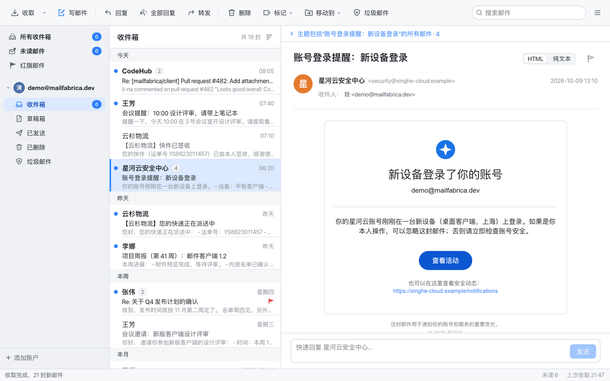
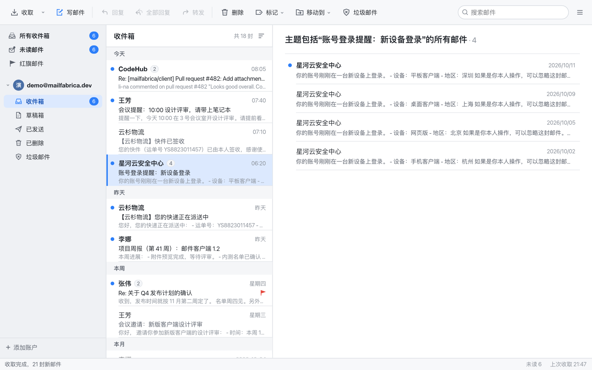
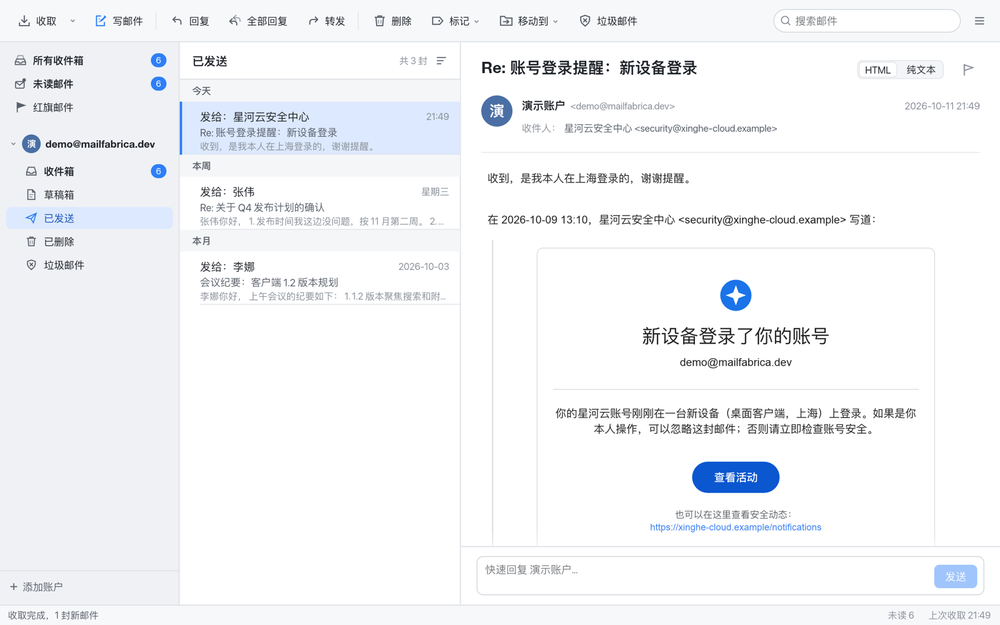

# MailFabrica

English | [简体中文](README.zh-CN.md)

A native desktop mail client written in Rust. The interface and workflow follow Foxmail; the engineering approach follows GridFabrica (layered crates, an egui UI, everything is a command, a control channel, MCP).

## Screenshots

The reading pane shows HTML mail as designed, close to what a browser renders. Messages with the same subject collapse into one row in the list:



Open a grouped row to see every message with that subject:



Replies to HTML mail quote the original with its formatting intact, in the same quote format Gmail uses:



The screenshots come from demo mode (`--demo`); all accounts and messages in them are made up. They show the Chinese UI; English is also available.

## Features
- **Three-pane layout**: account/folder tree (with unread counts) · message list grouped into Today / Yesterday / This week / This month / Older · reading pane with quick reply.
- **Toolbar**: get mail, write, reply, reply all, forward, delete, mark (read / unread / flagged), move to, junk, search.
- **Unified views**: all inboxes, unread, flagged (across accounts).
- **Compose**: multiple windows, recipient autocomplete (address book), attachments, save draft / continue from a draft, signatures, quoted replies, forwarding with the original attachments.
- **Accounts**: server settings filled in from the address (QQ/Foxmail, 163, 126, yeah, Sina, Aliyun, 139, Gmail, Outlook, iCloud, Yahoo, Zoho) and editable by hand; passwords are kept in the system keychain.
- **Protocols**: IMAP4rev1 (incremental UID sync, MOVE/UIDPLUS, Chinese folder names, the NetEase ID command) + SMTP (465 TLS / 587 STARTTLS, AUTH PLAIN/LOGIN).
- **Local storage**: one directory per account with a JSON index, the original `.eml` files and the address book; readable offline.
- **HTML mail**: laid out with blitz and rendered on the CPU, so CSS layout, buttons and images look as designed; remote images are loaded only from public internet addresses.
- **Group by subject**: messages with the same subject (ignoring prefixes like `Re:`, `Fwd:`, `回复：`) share one row; turn it off from the list menu or in Settings.
- **Chinese and English UI, light and dark themes**.
- **Scriptable**: every action is a command, callable from the control channel, the command line and MCP.

## Running
```sh
# Demo mode (in-memory fake server, no real account needed)
cargo run --release -p mailfabrica -- --demo

# Normal use (data lives in ~/Library/Application Support/MailFabrica; change it with --data or MAILFABRICA_HOME)
cargo run --release -p mailfabrica

# Command line
cargo run -p mailfabrica-cli -- --demo list
cargo run -p mailfabrica-cli -- account add me@qq.com --password-stdin
cargo run -p mailfabrica-cli -- sync && cargo run -p mailfabrica-cli -- list --unread
```
For QQ, 163, 126 and similar providers, first turn on IMAP/SMTP in the webmail settings and use the **authorization code** instead of your login password. For Gmail, use an app password.

Command line: `docs/cli.md`. MCP: `docs/mcp.md`. Control channel: `docs/control-protocol.md`. (These documents are in Chinese.)

## Development
- Architecture and conventions: `AGENTS.md`; releases: `docs/release.md`.
- Before committing: `cargo xtask ci` (fmt, clippy -D warnings, tests, layer check).

## Acknowledgements
Built with the help of [Claude Code](https://www.anthropic.com/claude-code) (Claude by Anthropic).

## License
MIT OR Apache-2.0.
