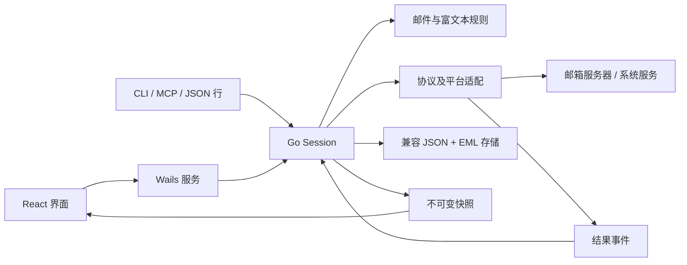

# Go + Wails 架构与邮件领域

## 背景和核心规则

MailFabrica 的桌面界面、CLI、MCP 与控制通道共用一套命令，不各自实现收发或数据变更。
`internal/engine/commands.json` 定义 82 个命令，包含 `ai.summarizeGroup`、`ai.scanJunk`、`account.markAllRead`、`contacts.suggest` 和 `contacts.timeline`；`Session.Execute` 是业务操作入口，`Snapshot` 形成不可变读取快照。

- 消息身份为账户 + UTF-8 文件夹路径 + UID；命令字符串为 `账户/uid/文件夹`，目录名继续使用 FNV-1a 64 位哈希。
- 只有会话持有 `Store`。远端协议返回纯数据；每个账户的网络任务串行，其他账户可独立推进；状态应用在会话锁内完成。
- UIDVALIDITY 改变时旧 UID 缓存失效，不能让同号旧 `.eml` 冒充新邮件。
- 正文、邮件头、命令参数及服务端回复均是不可信输入；附件、MIME、HTTP 响应、日期范围和命令数据均设限。
- HTML 在禁止脚本的隔离 iframe 中排版；宿主只提供固定阅读操作，不提供任意脚本执行。
- 写信内容、签名和原文引用分开处理。富文本命令使用 Unicode 字符偏移，界面通过 HTML 同步到同一模型。
- SMTP DATA 成功后 QUIT 断线不视为可重试发送失败；发送副本保存失败单独提示。
- 演示模式使用内存服务器及独立目录，不读取真实密码，也不查询真实系统日历。

## 模块

| 模块 | 职责与依赖 |
| --- | --- |
| `internal/mail` | 地址、账户、文件夹、消息、服务商、主题规则；不依赖 Wails、网络或存储 |
| `internal/store` | JSON/EML 兼容存储、原子写入、账户路径检查；依赖邮件类型 |
| `internal/protocol` | MIME、IMAP、SMTP、内存服务器；不持有 Store |
| `internal/platform` | 系统凭据与 EventKit 适配；不依赖 UI |
| `internal/ai` | 既有两种 AI HTTP 协议、URL 与响应限制；不读取邮箱或凭据 |
| `internal/invoice` | 发票附件筛选、命名与清单导出 |
| `internal/update` | 固定发布源、摘要/发布者校验与 macOS 安装交接 |
| `internal/engine` | 领域状态、会话、命令、视图、写信、后台编排；依赖上述适配，不依赖桌面框架 |
| `internal/control` | JSON 行、浏览器验收接口与 MCP；依赖引擎 |
| `internal/desktop` | Wails 桥接、文件对话框、固定 UI 操作、原生窗口关闭保护 |
| `frontend/src` | 按邮件、写信、账户、日历等功能组织组件；只通过命令与快照访问业务 |
| `cmd/*` | 桌面、CLI 和代码图标生成的装配入口 |
| `scripts/` | 检查、隔离端到端验证与本机打包 |

## 主要业务流程

添加账户：邮箱/服务商检测 → 校验配置 → 系统凭据 → 可选 IMAP 验证 → 保存账户 → 自动首次同步。
同步：列目录及 UID → 按 UIDVALIDITY 确认缓存基准 → 已知 UID 刷新标记、新 UID 获取元数据与有限正文 → 会话保存索引/原文 → 重建视图。
发送：校验地址和附件 → 生成 MIME → SMTP 接受 → 保存已发送副本 → 标记原信 → 更新联系人 → 关闭写信窗口。
发票导出：日期/邮件选择 → 获取原文 → 筛选附件 → 排他创建文件 → 写 UTF-8 CSV → 通过状态报告结果与失败。

## 界面

按用户确认的 Foxmail 紧凑方向实现：三栏直接占满客户区，只有栏间分隔线；默认 48px 双行邮件、日期分组、46px 工具栏与约 42px 快速回复。Magpie 提供配色和控件参考，不再保留外层圆角卡片。

UI 与引擎变更均需验证可观察结果。原生 WebView 的 DOM 截图不包含正文 iframe；完整正文视觉使用浏览器/真实窗口截图，不能混称。

日历来源样式：邮件使用账户色圆点，系统日程使用所属日历色竖线与浅色背景；全天日程底色更明显，定时日程附开始时间。复选框与内容共用来源颜色，筛选不重新分配颜色。今天有整格底色、选中日期描边。邮件悬停/键盘聚焦显示完整主题、发件人、日期时间与邮箱；日程提示名称、时间、来源与地点。

聚合邮件导航、AI 汇总和多地址写信的命令与数据流见 [conversations.md](conversations.md)。

联系人往来时间线通过 `contacts.timeline` 只读聚合本地跨账户邮件，按收发方向、月份和来源展示，支持分页及打开原邮件；规则与流程见 [contact-timeline.md](contact-timeline.md)。

## 账户一键已读与 AI 垃圾邮件清理

`account.markAllRead {id}` 将该账户全部文件夹的未读邮件标为已读，不受当前列表范围影响；与 `folder.markAllRead` 共用 `markAllRead`，最终经 `message.markRead` 写回服务器。已读和红旗先写本地索引并刷新视图；后台按账户 + 文件夹 + 标记合并为一次 IMAP 连接和分段 `UID STORE`（`Remote.SetFlags`），不逐封登录。服务器失败时回滚本地标记，相同错误去重后只提示失败封数和至多 3 条原因。

`ai.scanJunk {account?, folder?, limit?}` 默认检查当前列表，指定账户时检查其文件夹（默认收件箱）。跳过垃圾邮件、已删除、已发送和草稿，按时间取最近 `limit` 封（默认 100，最多 200）。只发送发件人、时间、主题和截断后的预览，不下载正文或附件。模型只返回编号数组，越界和重复编号被忽略，不信任模型给出的邮件键。每 10 封一批、最多 3 个请求并行；每批完成即在快照写回 `done`、`current`（正在识别的主题）和已发现候选，界面边识别边显示。部分批次失败时保留已识别结果，并提示未能识别的封数。

结果保存在快照 `aiJunk`（busy、scanned、candidates、error），只是建议。`ai.cleanJunk {keys?}` 只接受候选中的邮件，经 `message.junk` 移到各账户的垃圾邮件文件夹（同一文件夹合并为一次连接的 `Remote.MoveMany`），提交后界面直接关闭弹窗；扫描后已不存在的邮件直接从候选去掉。`ai.clearJunk` 清空结果。实现见 `internal/engine/junk.go` 和 `frontend/src/junk-dialog.tsx`。
