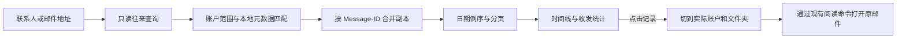

# 联系人往来邮件时间线

## 背景与入口

跨多个邮箱账户查找与某位联系人的往来时，按主题分组的收件箱不能完整展示时间顺序。时间线以邮箱地址为联系人身份，按日期展示收到、发出及共同收件/抄送的邮件，无需先把此人保存到地址簿。

入口为阅读头的发件人/收件人名称，以及联系人列表的“查看往来邮件”按钮。默认跨全部账户，可以切换单个账户；点击记录打开其实际文件夹和原邮件，支持直接给联系人写信。

## 核心规则

- `contacts.timeline {email, account?, offset?, limit?}` 为只读命令，CLI/MCP 与界面使用同一入口。`email` 必须恰好一个有效地址，忽略邮箱大小写；`account` 为空表示全部账户，非空须为已有账户。每页默认 50，范围 1–100，`offset` 为 0–1000000 的整数。
- 只查询本地已同步的元数据，不联网搜历史、下载正文或改变已读状态。新邮件同步后点击刷新更新列表；无记录时提示暂无缓存。
- 匹配邮件头的 From、To 和 Cc。发件人为自己的账户且目标在 To/Cc 中时记为发出；目标是发件人时记为收到；其他同时出现在 To/Cc 的邮件记为共同收件。BCC 不在收到的邮件头中，不推测或扩展隐藏收件人。
- 草稿、垃圾箱、已删除目录，以及带 Draft/Deleted 标志的记录排除。收件箱、已发送、归档和普通自建文件夹均参与。
- 同一 Message-ID 在当前账户筛选范围内合并；缺少 Message-ID 时以账户/文件夹/UID 为身份，不猜测重复。保留所有副本位置；发出优先定位已发送，其余优先收件箱，同角色按邮件键稳定选择。
- 按日期倒序，同一日期按邮件键稳定排序。统计数量按筛选及去重后的全集计算，分页不会改变总数。界面按月份分组、按收发方向标记，并显示实际邮箱服务商和文件夹。

## 实现与验证

- `internal/engine/contact_timeline.go`：参数校验、匹配、收发分类、去重、分页；不依赖桌面框架。
- `frontend/src/contact-timeline.tsx`：日期轴、账户筛选、加载更多、空状态与失败重试；筛选变化丢弃过期查询。
- `internal/engine/contact_timeline_test.go`：跨账户、双方收发、共同抄送、重复副本、分页、无记录、非法参数，以及只读状态保持。

时间线记录的打开沿用现有“打开邮件时自动标为已读”偏好。未同步到本地的历史不在时间线中；需要先通过正常收取邮件流程同步。
