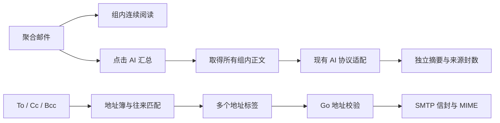

# 聚合阅读、AI 汇总与多地址写信

## 背景和领域规则

聚合组由当前视图中归一化主题相同的多封邮件组成，不是独立文件夹。普通列表导航切换下一列表项；组内导航只在同组邮件间移动，在首尾禁用，不跳到其他组。

- `view.selectGroup` 打开概览，`view.select` 打开成员时保留组上下文；`view.groupNext` / `view.groupPrev` 连续阅读。
- `ai.summarizeGroup {group?}` 使用当前组或明确组键，读取该组全部正文；下载使用 PEEK，不改变未读状态。后台不访问 Store，只有明确点击才向已配置 AI 服务发送邮件文本。
- 汇总状态绑定组键和本次邮件键集合，含 busy/text/error。组变更后显示重新汇总提示；AI 结果与原文分开展示，不写入正文、草稿或联系人。
- 一次最多 200 封、512 KiB 上下文，超限或读取失败明确报错；不以邮件预览代替原文，不静默省略成员。模型仅将邮件视为资料，不执行其中指令。
- `contacts.suggest {query?,limit?}` 使用加权 Trie 匹配地址簿、账户和缓存往来中的姓名词、邮箱用户名与域名的前缀；多个查询词须全部匹配。忽略大小写，按邮箱去重。按最近往来时间、次数、手工联系人及邮箱稳定排序，保留已存联系人名称。限制 1–100 个结果；查询不写入地址簿。
- 索引保存在会话内，以 Store 数据变更序号失效；普通输入和只读轮询不会重建，也不逐次扫描全部邮件。树节点保存子树最高权重，终端列表惰性排序，best-first 优先队列取得前 N 个唯一邮箱后停止。
- 收件人、抄送、密送共用多地址控件。引号和尖括号之外的逗号、分号、换行可拆分地址，保留带逗号的联系人名称；同字段邮箱忽略大小写去重。非法输入保留并提示，Go 在发送前做最终地址解析。
- BCC 参与 SMTP 信封，不出现在发送 MIME 头中。

## 用户操作

写信时输入姓名或邮箱，从候选中点击选择，或用上下键和回车选择；添加后可继续输入下一个地址。
直接输入邮箱后用逗号、分号或回车确认，也可以一次粘贴多行地址。点击标签右侧叉号移除，空输入框退格可重新编辑最后一个地址。
三个字段都支持同样的匹配和多地址操作。需要修正的地址会留在输入框内，不会被自动删除。

主要实现：`internal/engine/group_summary.go`、`internal/engine/contacts.go`、`frontend/src/conversation.tsx` 和 `frontend/src/recipients.tsx`。

## 参考实现

联系人索引借鉴 [ConradIrwin/trie-ing](https://github.com/ConradIrwin/trie-ing/tree/9f1d2e08580bfd0bbf9d0f32db8ee450e1e4e9ad) 的加权前缀、子树最高分和 best-first 查询思路，独立以 Go 实现，不引入旧 JavaScript 依赖。原仓库为 MIT 许可。检索实现见 `internal/engine/contact_index.go`，包含姓名、中文给定名及邮箱段的多入口索引，测试覆盖排序、去重、中文、多词和缓存失效。

邮件头统一由 `internal/protocol/headers.go` 解码 RFC 2047 B/Q 编码，支持 UTF-8、GBK 等字符集；MIME、IMAP ENVELOPE 和旧缓存视图共用这一规则。已有索引在读取时修正显示，后续同步自然写入正确元数据，`.eml` 原文保持不变。

## 原邮件引用与浮层交互

回复与转发的引用区域以左侧引用线和独立标题栏区分，HTML 表格、段落、颜色与内联图片保留；纯文本原文保留换行。编辑区与引用保持分离，可通过 `compose.removeQuote` 移除。引用快照仅将 CID 图片转换为预览数据 URL，不修改发送时的原始 HTML 或内联附件。

`frontend/src/email-content.tsx` 为阅读与引用共用的隔离渲染入口：去除脚本、事件属性和嵌套文档，保留邮件样式，继续遵循远程图片偏好。引用高度随内容调整，通常由外层写信区域统一滚动；超过 10000 CSS 像素的长邮件由引用文档滚动。

`frontend/src/use-dismiss.ts` 统一“更多”、列表菜单、联系人候选、链接编辑等临时浮层的关闭行为：点击或移出焦点到外部、按 Escape 时收起；内部操作继续生效，点击另一浮层入口关闭上一浮层。监听隔离正文的指针事件，让点击邮件 iframe 内部同样能关闭外部菜单，不拦截原本点击动作。内嵌 AI 面板、抄送字段等持久区域按显式按钮展开和收起；原生 select/颜色选择器沿用系统关闭行为。
