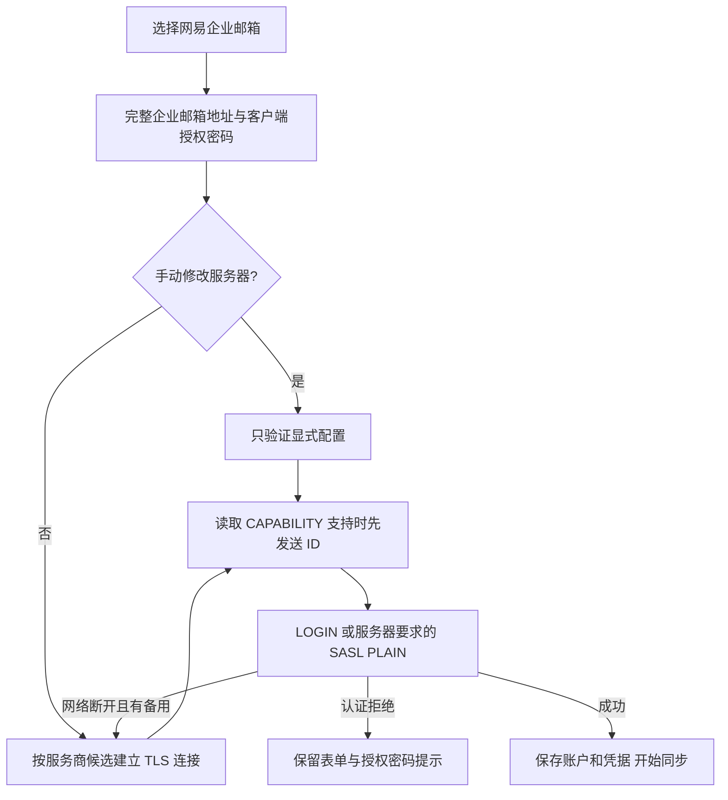

# 网易企业邮箱接入

企业邮箱使用自己的域名，不能按邮箱域名推断出网易服务器。添加账户时选择“网易企业邮箱”，引擎收到 `account.add {provider:"qiye163", email, password}` 后应用服务商预设；CLI/MCP 与 GUI 使用同一规则。

默认使用 `imap.qiye.163.com:993` 和 `smtp.qiye.163.com:465`，均为 TLS。未手动修改服务器时，网络断开后尝试网易的 `imaphz/smtphz`、`hwhzimap/hwhzsmtp` 备用服务器。用户显式修改的主机、端口、加密方式优先，不被自动探测覆盖。认证拒绝立即停止，避免重复尝试被拒绝的凭据。

网易企业 IMAP 代理可能在认证期间检查客户端。网络连接先读取能力列表；服务器支持 `ID` 时，在 LOGIN 前发送真实的 MailFabrica 名称、版本和 vendor，登录后保留 ID 兼容后端切换。ID 不包含账号、密码、设备标识。对不支持 ID 的服务器不发送。ID 被服务器以 NO/BAD 拒绝时沿用原认证流程；网络断开则报告错误。

密码应是客户端授权密码。在网页邮箱的“设置 → 账号与安全 → 客户端设置”中开启 IMAP/SMTP，生成授权密码并确认生效后复制。若报 IPDENY，联系管理员检查访问策略。参考 [网易授权密码入口](https://mail.qiye.163.com/static/commonweb/authcode.html?p=qiye-authcode)；具体服务器以网页邮箱提供的客户端设置为准。

测试使用要求认证前 ID、否则直接 EOF 的模拟代理，旧流程可复现 `connection closed by server`，修复后通过；服务商参数测试验证默认配置、显式覆盖与非法 provider。真实握手及 CAPABILITY 验证不使用用户凭据，不能替代真实账户登录验收。

## 连接断开诊断

连接错误保留失败阶段：`DNS`、`TCP connect`、`TLS handshake`、`IMAP greeting`、`CAPABILITY`、`ID`、`IMAP authentication: LOGIN/AUTHENTICATE PLAIN`、`IMAP post-login`。阶段只包含固定标签和命令名，不包含命令参数、登录名或密码。网络、TLS、I/O、协议错误的分类保持不变；认证拒绝仍返回原始服务器原因。

所有候选失败时，`attempts` 列出各服务器的具体原因，避免首个连接断开掩盖备用服务器的证书或超时错误。`IMAP post-login` 表示服务器已接受登录，但后续能力查询或 ID 失败，不能直接认定是密码错误。客户端不会因这个诊断变化而放宽证书校验、跳过认证或保存未经验证的账户。

诊断回归覆盖 LOGIN 直接 EOF、登录后 ID EOF、认证前 CAPABILITY EOF、SASL 继续请求 EOF 及多候选失败原因；这些测试只验证错误定位，不代表真实账户接入已通过。

## 认证拒绝与兼容回退

按 [RFC 3501 §6.2.3](https://www.rfc-editor.org/rfc/rfc3501.html#section-6.2.3)，`LOGIN NO` 是认证拒绝，`LOGIN BAD` 是命令不支持或参数错误。两者不能合并处理：即便能力列表声明 `AUTH=PLAIN`，NO 后也立即返回 `MailError::Auth`，显示原始拒绝原因，不再次发送凭据，也不遍历备用服务器。同步字面量在收到继续请求前被 NO 拒绝时遵循同一规则。

只有 BAD 且支持 PLAIN 时执行一次 SASL 兼容回退；回退连接断开时保留第一次 LOGIN 的错误信息。`LOGINDISABLED` 仍直接使用 PLAIN。其他邮件命令的 NO/BAD 仍是 `MailError::Server`。这个修复解决了“LOGIN 拒绝 → 再次认证 → EOF → 被提示检查网络”的错误链，但不会绕过服务器的授权密码、客户端启用或访问策略校验。
