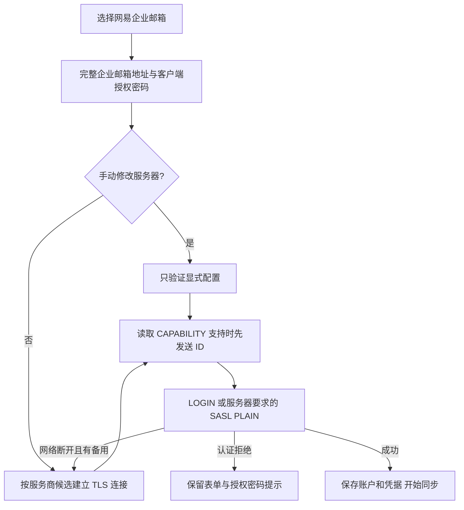

# 网易企业邮箱接入

企业邮箱使用自己的域名，不能按邮箱域名推断出网易服务器。添加账户时选择“网易企业邮箱”，引擎收到 `account.add {provider:"qiye163", email, password}` 后应用服务商预设；CLI/MCP 与 GUI 使用同一规则。

默认使用 `imap.qiye.163.com:993` 和 `smtp.qiye.163.com:465`，均为 TLS。未手动修改服务器时，网络断开后尝试网易的 `imaphz/smtphz`、`hwhzimap/hwhzsmtp` 备用服务器。用户显式修改的主机、端口、加密方式优先，不被自动探测覆盖。认证拒绝立即停止，避免重复尝试错误凭据。

网易企业 IMAP 代理可能在认证期间检查客户端。网络连接先读取能力列表；服务器支持 `ID` 时，在 LOGIN 前发送真实的 MailFabrica 名称、版本和 vendor，登录后保留 ID 兼容后端切换。ID 不包含账号、密码、设备标识。对不支持 ID 的服务器不发送。ID 被服务器以 NO/BAD 拒绝时沿用原认证流程；网络断开则报告错误。

密码应是客户端授权密码。在网页邮箱的“设置 → 账号与安全 → 客户端设置”中开启 IMAP/SMTP，生成授权密码并确认生效后复制。若报 IPDENY，联系管理员检查访问策略。参考 [网易授权密码入口](https://mail.qiye.163.com/static/commonweb/authcode.html?p=qiye-authcode)；具体服务器以网页邮箱提供的客户端设置为准。

测试使用要求认证前 ID、否则直接 EOF 的模拟代理，旧流程可复现 `connection closed by server`，修复后通过；服务商参数测试验证默认配置、显式覆盖与非法 provider。真实握手及 CAPABILITY 验证不使用用户凭据，不能替代真实账户登录验收。
