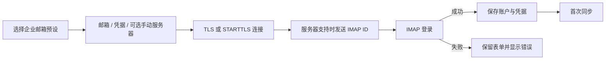

# 网易企业邮箱接入

## 账户与预设

使用自有域名的企业邮箱，添加账户时应选择“网易企业邮箱”，通过 `account.add {provider:"qiye163", email, password}` 使用服务商预设。桌面、CLI 和 MCP 调用同一账户命令。

候选地址由 `internal/mail/model.go` 的 `ServerCandidates` 定义：

| 顺序 | IMAP | SMTP |
| --- | --- | --- |
| 默认 | `imap.qiye.163.com:993` | `smtp.qiye.163.com:465` |
| 备用 | `imaphz.qiye.163.com:993` | `smtphz.qiye.163.com:465` |
| 备用 | `hwhzimap.qiye.163.com:993` | `hwhzsmtp.qiye.163.com:465` |

这些预设均使用 TLS。用户显式修改主机、端口或加密方式时，以手动配置为准。服务器的最终要求应以对应邮箱的客户端设置为准；若提供商要求客户端授权码，应使用授权码而非网页登录密码。

## 验证与同步

添加账户默认先验证 IMAP，成功后保存账户和凭据并开始首次同步。SMTP 凭据在实际发送时验证。编辑账户时密码留空保留既有凭据。

`internal/protocol/remote.go` 建立连接、设置超时与取消，在支持 `ID` 的服务器上于登录前发送 MailFabrica 名称、版本和 vendor，再通过协议库执行登录。ID 不携带账户密码或设备标识。

认证失败会通过 `IMAP 登录失败` 包装服务器错误，界面保留错误和输入。连接和证书问题不会通过关闭 TLS 验证来绕过。

## 验证范围

`internal/protocol/remote_test.go` 覆盖模拟 IMAP/SMTP、认证前 ID、增量同步、中文文件夹、邮件标记、发送和连接失败；`internal/engine` 的账户测试覆盖预设与参数校验。模拟服务器通过不代表任意企业邮箱的真实凭据或访问策略已通过。
