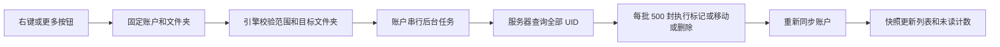

# 文件夹邮件批量操作

账户下的可选文件夹支持右键菜单，也可通过悬停或键盘聚焦时显示的“更多”按钮打开。菜单作用于该文件夹内的邮件，不删除文件夹本身，不改变当前邮件范围、搜索条件或选择。

- **全部标记为已读**：将该文件夹服务器上的全部邮件标记为已读。
- **删除**：确认后将全部邮件移到同账户的“已删除”。“已删除”中的菜单显示“永久删除”，确认后永久删除。
- **移动到垃圾邮件**：将全部邮件移到同账户的垃圾邮件文件夹；垃圾邮件文件夹中的该项禁用。

确认删除后立即隐藏源文件夹及受影响范围的计数，右下角显示“正在删除…”。该提示持续到后台操作和账户同步结束，随后显示完成或失败状态；失败后恢复服务器实际计数。取消确认不改变计数。

## 命令与实现

界面通过 `Session.Execute` 调用，CLI、控制通道及 MCP 使用相同命令：

| 命令 | 参数 | 含义 |
| --- | --- | --- |
| `folder.markAllRead` | `{account, folder}` | 对指定文件夹执行服务器端全部已读 |
| `folder.deleteMessages` | `{account, folder}` | 全部移到已删除；源为已删除时永久删除 |
| `folder.junk` | `{account, folder}` | 全部移到垃圾邮件 |

`folder.markAllRead` 省略参数时取当前范围；当前为具体文件夹时同样走服务器端全部已读，其它范围保留历史行为。新命令要求显式账户和文件夹，校验账户及文件夹存在且可选择。程序化调用直接执行，不弹确认框；删除确认由 UI 提供。

`protocol.Remote.ChangeFolder` 由 Network 与 Memory 实现。Network 在同一连接内查询完整 UID 集合并分批处理，覆盖默认同步窗口以外的旧邮件，不下载正文。单次最多支持 200 万封，与现有同步上限一致。移动沿用 MOVE 或 UIDPLUS 的安全回退；永久删除要求 UIDPLUS，不使用全局 EXPUNGE。

操作不保证跨批次事务性；服务器中途失败时保留错误，并重新同步已完成的部分。重新同步也可能失败，此时错误保留在状态中，可重新收取邮件。全量范围取服务器查询 UID 时的快照，不包含随后到达的新邮件。

## 验证

引擎测试覆盖指定范围不受搜索影响、未缓存邮件、空目录、非法参数、移入自身、永久删除及部分失败后的同步。协议测试通过真实本地 TCP IMAP 服务验证整目录已读覆盖同步窗口外的邮件。浏览器验收使用真实 Go 引擎的隔离演示账户，不操作真实邮箱。
