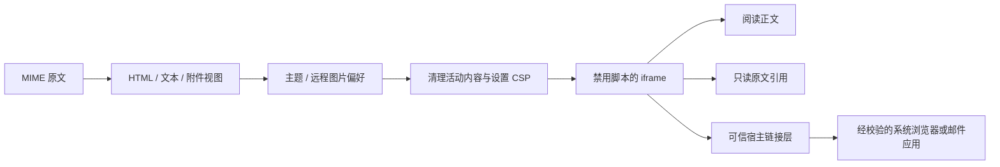

# HTML 邮件显示

## 领域与入口

邮件正文属于不可信内容，与邮件列表、工具栏、联系人和写信编辑区隔离。桌面使用 Wails 的系统 WebView；阅读正文和只读原文引用共用 `frontend/src/email-content.tsx`，不维护第二套渲染器。

Go MIME 解析器在 `internal/protocol/mime.go` 中生成 HTML、纯文本、附件和内嵌资源视图；前端依据当前主题、远程图片偏好和阅读模式生成独立文档。

## 核心规则

- 正文通过 `srcDoc` 放入 iframe，sandbox 不授予 `allow-scripts`，也不向正文提供 Wails 桥接。
- 移除脚本、嵌套框架、表单、可执行事件属性等内容；CSP 限制资源和导航来源。
- CID 图片由后端映射为数据 URL。远程图片默认开启，关闭后不加载远程图片资源；阅读和引用共用同一偏好。
- 保留原 HTML 表格和样式；纯文本使用转义后的 `pre` 显示，保留换行。
- 阅读窗格的邮件头、工具栏和快速回复固定，正文与附件区域滚动。写信引用根据内容高度伸展，随写信区域滚动。
- 引用与可编辑正文分开；显示可移除的引用标题和边线，发送时由 MIME 组装合并，不把预览用的资源映射直接保存为新邮件内容。

## 链接与 WebKit

HTTP、HTTPS、mailto 经前后端校验后交给系统应用打开；`javascript:`、`data:`、`file:` 等链接不开放。页内锚点留在正文内跳转。

WebKit 在禁用正文脚本时也会拦截附加到正文文档内的事件回调，因此桌面通过 `email-links.tsx` 在可信父页面建立静态链接点击区域。滚动或排版变化时刷新位置，指针点击时再次命中原文。该处理不放开邮件脚本，也不覆盖非链接区域的选择和滚动。

## 验证

运行 `make check`、`make build` 和 `python3 scripts/smoke.py`，验证 MIME、引用和发送的数据流。实际排版、滚动、链接与菜单交互还需要浏览器或原生窗口验收。

固定自动化方法见 [control-protocol.md](control-protocol.md)。`ui.screenshot` 导出应用 DOM，不包含正文 iframe，不能作为完整正文截图；使用浏览器截图或操作系统窗口截图验证完整显示。
