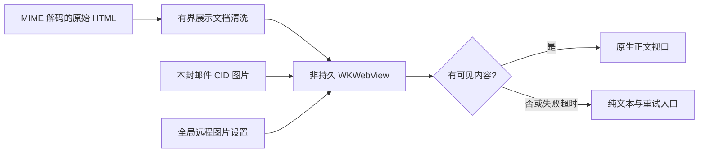
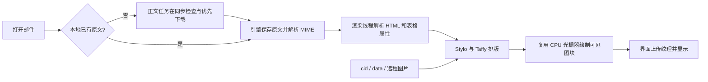

# HTML 邮件预览与下载

邮件模板经常用嵌套表格、`cellpadding`、`cellspacing` 和单元格背景组织内容。阅读器需要尽快显示正文，并保留模板的间距、按钮、图片和中文排版。

## 系统浏览器正文（macOS）

macOS 桌面阅读窗格用系统 WKWebView 排版原始 HTML 的清洗副本，不再用自绘图块模拟浏览器。
邮件头、附件和快速回复仍由 egui 显示，正文拥有自己的滚动、选择和复制。
Windows/Linux 以及写信窗口的只读引用仍使用下文的 Blitz 渲染器。

`ui-egui::browser` 只定义正文视口和状态；`apps/mailfabrica/src/browser.rs` 负责原生控件，
通过 eframe 的安全窗口句柄创建子视图，不向引擎引入窗口依赖，也不增加 unsafe 代码。
`html::prepare_document` 使用 HTML5 清洗器保留表格、class、内联 CSS 和媒体查询，移除脚本、
表单、子框架、自动跳转和 base。原始 `.eml` 与回复正文不被改写。



- 网页 JavaScript 在 WKWebView 配置中禁用，文档再以 CSP 禁止脚本、子框架、表单、外部样式表和字体。
  宿主只执行固定的可见内容检查脚本，没有网页 IPC、命令或凭据接口。
- 全局 `Prefs.remote_images`（JSON `remoteImages`）默认开启；旧配置缺少该字段时同样开启。
  “设置 → 阅读 → 自动加载远程图片”通过 `app.prefs {remoteImages: bool}` 持久化；换信、正文刷新和重启沿用此值。
  改变设置会重建当前 WebView，关闭时 CSP 只允许 `cid:` 和 `data:` 图片；Blitz 正文和写信引用也重建以应用设置。
  重试对应 `ui.readerReload {}`，控制通道和 MCP 均可调用。
- CID 从当前邮件附件的内存副本提供，只接受可识别的 PNG/JPEG/GIF/WebP/BMP/ICO，单张 8 MiB、合计 20 MiB、最多 128 项。
  自定义协议不能访问磁盘或其他邮件；原生浏览器使用非持久数据存储，不共享登录态。
- 网页内的 http(s)、mailto 和 tel 链接交给既有 `ui.openUrl` 系统处理，禁止正文导航、弹出窗口和下载。
  菜单、模态框、写信、日历、纯文本模式或邮件切换时隐藏正文原生覆盖层，防止遮住操作界面。
- HTML 原文超过 2 MiB、初始化失败、10 秒内未出现可见正文或加载完成后没有可见文字/图片时，显示纯文本并提供重试。
  代号及每实例事件队列隔离异步结果，旧邮件的回调不能更新新邮件。
- 正文在 DOM 提交后即可显示，不等待慢速远程图片下载完成。
- `ui.inspect.reader.browser` 提供 `backend/status/error/remoteImages/generation/visible/rect`。
  原生 WebView 不在 egui 的 GPU 纹理里，`ui.screenshot` 不包含正文覆盖层；视觉验收应捕获真实 macOS 窗口。

使用说明见 [邮件正文阅读](mail-reading.md)。

## 下载规则

- 每个账户仍只有一条工作线程、一条复用的 IMAP 连接。后台线程只发事件，引擎负责存储和正文缓存。
- 同步在列文件夹、下载邮件头、刷新标记和预取正文之间检查任务队列。用户打开的正文优先处理，无需等待整个同步完成；正在执行的网络请求无法中断。
- 每个检查点最多处理 16 个正文请求。读取可以越过标记任务，移动、删除、配置验证等任务构成顺序屏障；修改任务之间保持原顺序。
- 预取只选最新且小于 512 KiB 的邮件，每批最多 8 封。真实连接使用 `UID FETCH ... BODY.PEEK[]`，不改变已读状态。断线仍由原有连接恢复逻辑处理；缺失 UID 不伪造正文。
- 已在当前同步期间为用户下载的正文不重复预取，避免重复网络传输和重建预览。UIDVALIDITY 变化时清除对应去重记录。

## Blitz 预览概念与流程（其他平台与写信引用）

### 纯文本正文和列表摘要

阅读窗格由固定邮件头、可滚动正文、固定快速回复三部分组成。`ui-egui::reader::show` 先分配顶部和底部面板，再让正文滚动区使用剩余空间；标题、收发件人、日期及 HTML / 纯文本切换不会随正文移动。附件、加载提示和失败重试入口位于同一个正文滚动区，滚动位置按邮件键隔离。

`mime::html_to_text` 使用 `html2text` 将 HTML 正文转换为纯文本，关闭转换器自动绘制的表格边框。
邮件模板常用嵌套表格做布局，生成的横线会干扰阅读并占满 160 字符的列表摘要。
转换仍保留表格单元格文字和段落；原始 HTML、邮件自带的纯文本以及正文中的分隔符不修改。

存储首次加载文件夹索引时，对包含旧版 `─` 边框字符的摘要，从已有 `.eml` 原文重新计算并保存摘要。
只更新摘要，不修改邮件头、标记、附件信息和原文，不触发网络下载；原文缺失、不可读或无法得到非空摘要时保留旧值。
摘要未变化时不写索引，正常摘要不读取原文，因此重复打开不会反复写入。

`HtmlView` 是渲染线程句柄，`Layout` 表示排版代和尺寸，`Tile` 是 512 CSS 像素高的预乘 RGBA 图块。界面只请求可见区域附近的图块。



## 兼容与性能

- `html/src/compat.rs` 将有界、合法的旧式表格像素属性映射为 UA 样式。普通属性规则允许作者 CSS 覆盖。
- 当前 Blitz 的折叠表格实现会读取无边框单元格的默认宽度，还会把第一格的单边装饰扩散到整张表。兼容层将默认表格边框宽度设为零，并将无 `rules` 的 `border="0"` 表改为分离模型，默认间距为零。这条模型规则使用 UA `!important`，以绕开作者的全局 `border-collapse:collapse`；显式单元格边框保留。复杂数据表的折叠边框仍受上游实现限制，不能视为完整浏览器兼容。
- 启用复杂文字断行支持，系统字体发现和字体文件缓存在预览之间复用；每封邮件的字体集合独立，远程字体不会跨邮件注册。
- 光栅器在图块之间复用图片转换缓存。图片到达后使用当前视口重新排版，避免重复重建样式设备。
- 远程资源和 HTTP 连接可跨预览复用。资源缓存只在内存中保存成功结果，最多 32 MiB / 128 项、有效期五分钟；关闭远程图片时不会读取它。公网地址校验、无 Cookie、资源大小与超时限制仍生效。
- 收到图块后清除“正在请求”标记；界面释放远处纹理后可以再次请求。旧排版代的图块不上传，避免缩放或图片加载时覆盖新内容。
- 首次排版显示本地化加载提示；渲染失败后退回原有文字预览。

## 验证

```sh
cargo test -p mailfabrica-html -p mailfabrica-sync -p mailfabrica-proto
cargo xtask ci
# macOS：构建后用一次性离线邮箱验证真实 WKWebView（只请求脚本自建的回环图片服务）
python3 xtask/browser_qa.py target/debug/mailfabrica --result /tmp/browser-qa.json
cargo run -p mailfabrica-html --example preview -- /tmp/input.html /tmp/preview.png
```

最后一个命令走正式渲染线程，打印三次排版及首块耗时，保存首块 PNG；默认不联网，加 `--remote` 开启远程图片。PNG 是首块快照，图片可能尚未到达。真实阅读窗格需使用桌面程序和控制通道截图检查；不要把离线渲染耗时当作真实邮箱下载速度。
