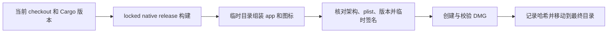

# 本地 macOS 应用包

`cargo xtask package` 将当前 checkout 的 release 构建打成 Finder 可打开的应用和 DMG。此流程不推进版本号、不打标签、不推送、不发布、不安装到 `/Applications`。

## 使用与产物

```sh
cargo xtask ci
cargo xtask package
```

产物位于 `dist/MailFabrica-<版本>-<架构>/`：

- `MailFabrica.app`：包含桌面程序、`Contents/MacOS/mailfabrica-cli`、应用图标和许可证。
- 同名 `.dmg`：包含应用、指向 `/Applications` 的快捷方式和安装说明。
- `MailFabrica-logo.png`：1024×1024 透明背景 logo。
- `build.json`：Git revision、工作区是否有改动、架构、时间、两个程序及 DMG 的 SHA-256。

开发版接 Git 短哈希，工作区不干净时再接 `+`。`Info.plist` 的数字版本是 Cargo 版本去掉开发后缀的部分。版本来源始终是根 `Cargo.toml`。

## 流程与边界



只支持当前 macOS 本机架构，设置了 `CARGO_BUILD_TARGET` 时拒绝执行。复用 Cargo 的 `target_directory`，不覆盖既有产物目录；失败时清理临时目录。

应用采用 ad-hoc 本地签名，未经过 Apple 公证。面向公众的签名、公证及发布需要另行配置。

## Logo

原创蓝色圆角底、白色信封与青色交织线，呼应 Mail 与 Fabrica。`xtask/src/icon.rs` 用矢量路径绘制，不在源仓库存放位图或字体。打包时生成 16–1024 像素 PNG，并由系统 `iconutil` 组装 `.icns`。

只预览 logo，无需构建应用：

```sh
cargo xtask icon
```

命令写入 `dist/MailFabrica-logo.png`。图形变更需检查大小尺寸；打包逻辑变更需实际生成应用和 DMG，并验证包内程序启动。
