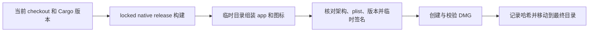

# macOS 构建与公证

Windows/Linux 使用同一 `cargo xtask package` 入口生成 portable 包，见 [跨平台发布](portable-release.md)。

`cargo xtask package` 将当前 checkout 的 release 构建打成 Finder 可打开的应用和 DMG。此流程不推进版本号、不打标签、不推送、不发布、不安装到 `/Applications`。

## 使用与产物

```sh
cargo xtask ci
cargo xtask package
```

产物位于 `dist/MailFabrica-<版本>-<架构>/`：

- `MailFabrica.app`：包含桌面程序、`Contents/MacOS/mailfabrica-cli`、应用图标和许可证。
- 同名 `.dmg`：包含应用、指向 `/Applications` 的快捷方式和安装说明。
- `MailFabrica-logo.png`：1024×1024 透明背景 logo。
- `build.json`：Git revision、工作区是否有改动、架构、时间、两个程序及 DMG 的 SHA-256。

开发版接 Git 短哈希，工作区不干净时再接 `+`。`Info.plist` 的数字版本是 Cargo 版本去掉开发后缀的部分。版本来源始终是根 `Cargo.toml`。

## 流程与边界



只支持当前 macOS 本机架构，设置了 `CARGO_BUILD_TARGET` 时拒绝执行。复用 Cargo 的 `target_directory`，不覆盖既有产物目录；失败时清理临时目录。

默认采用 ad-hoc 本地签名，未经过 Apple 公证。ad-hoc 签名每次打包都不同，钥匙串认不出新包，装上后读邮箱密码会再弹授权框（"始终允许"也要重新点）。
本机有 Developer ID 证书时，只设置签名身份即可打签名的本地包：不公证，不检查版本号和工作区，但签名每次相同，点过一次"始终允许"后，之后的包都不会再问：

```sh
APPLE_SIGN_IDENTITY='Developer ID Application: Name (TEAMID)' cargo xtask package
```

正式包需要再加上公证 profile，两个都是非秘密配置名称，凭据保留在 macOS 钥匙串中：

```sh
APPLE_SIGN_IDENTITY='Developer ID Application: Name (TEAMID)' \
APPLE_NOTARY_PROFILE='existing-keychain-profile' \
cargo xtask package
```

正式模式要求版本不含 `-dev`、工作区完全干净，`v<version>` 注释标签指向当前 HEAD 且属于本地 `master`。发布前还必须确认标签已在 `origin/master` 上。打包不会创建标签或推送。

打包为两个可执行文件及应用启用 Developer ID、安全时间戳与 Hardened Runtime，并对 DMG 签名；只签名的本地包同样签名 DMG。先提交应用 ZIP 给 Apple，等待 Accepted 并 staple 应用，再生成、签名、公证与 staple DMG；两者都验证票据和 Gatekeeper 判定。`dist/notary-<包名>/` 保存 submission UUID、结果与 Apple 日志；等待超时不等于成功，按 UUID 查询后处理。

`build.json` 记录签名方式、公证状态、两个 submission UUID，以及 staple 后最终文件的 SHA-256。公开发布必须使用这些最终文件，不可重新签名或修改它们。

## Logo

原创蓝色圆角底、白色信封与青色交织线，呼应 Mail 与 Fabrica。`xtask/src/icon.rs` 用矢量路径绘制，不在源仓库存放位图或字体。打包时生成 16–1024 像素 PNG，并由系统 `iconutil` 组装 `.icns`。

启动时显式使用系统应用图标，防止 eframe 默认 logo 覆盖包内的 `.icns`，保证 Finder 和 Dock 显示同一图形。

只预览 logo，无需构建应用：

```sh
cargo xtask icon
```

命令写入 `dist/MailFabrica-logo.png`。图形变更需检查大小尺寸；打包逻辑变更需实际生成应用和 DMG，并验证包内程序启动。
