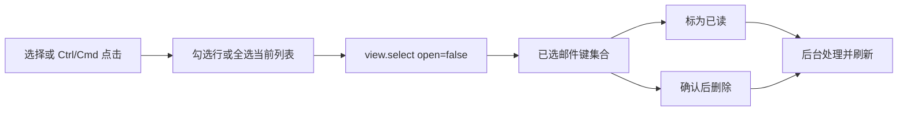
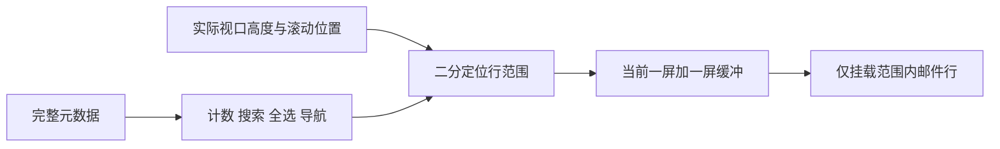

# 邮件列表

Go + Wails 中栏由 `frontend/src/mail-list.tsx` 提供批量操作、`mail-list-rows.tsx` 渲染窗口化列表；阅读区位于 `mail-view.tsx`。数据和变更通过 Go 命令引擎。

- 默认紧凑双行列表：48px 行高，上行发件人与日期，下行主题；未读、主题组计数、红旗和附件图标保留。
- 按今天、昨天、本周等日期分组；紧凑模式隐藏正文摘要和头像，优先展示更多邮件。
- 主题归类、组内导航、多选、搜索、按时间排序仍由引擎处理。
- 左侧聚合行的数量为“未读/总数”（例如 `2/5`），全已读时仍显示 `0/5`；悬停和辅助技术可读取完整含义，长发件人名称不会挤掉数量。
- 聚合概览逐封显示未读圆点与“未读/已读”标签，未读发件人和主题加粗；概览标题同时给出总数和未读数。只打开概览不改变已读状态，打开单封时沿用自动已读偏好，手动标记和同步结果会刷新标识及计数。
- 三栏直接占满窗口客户区；不在邮件列表或阅读区外再套圆角卡片。
- 两条栏间分隔线可拖动，宽度保存到偏好。工具按钮、搜索和行选择提供稳定可访问名称与控制标识。

运行 `make demo` 检查实际界面；控制通道截图的能力边界见 [control-protocol.md](control-protocol.md)。

账户标题按完整邮箱地址显示，单行超宽省略并可悬停查看完整地址；提供商标记以 IMAP/SMTP 主机优先识别，邮箱域名作为回退，支持自定义域名企业邮箱。

## 中栏多选与批量操作

点击列表标题旁的“选择”进入多选模式；每行显示勾选框，工具栏提供“全选”、已选邮件数、“已读”和“删除”。主题组的勾选作用于整组，数量按实际邮件封数计算，部分选中显示中间状态。多选模式内点击行也可以切换勾选，不会打开邮件或自动标为已读。

- Ctrl/Cmd 点击可以进入多选并增减选择；列表聚焦时 Ctrl/Cmd+A 选择当前列表，Escape 或“完成”清空选择并退出。
- 全选作用于当前范围和搜索结果中的全部已加载邮件，包含滚动区域之外的行，不自动选择后来收到的新邮件；单次最多 10000 封。
- “已读”仅对选中的邮件调用 `message.markRead {keys, read:true}`。
- “删除”先确认实际封数，再调用 `message.delete {keys}`：移到各自账户的已删除文件夹，已在已删除中的邮件会明确提示永久删除。
- 删除确认后，所选行交错淡出并收起，动画总长约 1.2 秒，与网络耗时无关；列表可继续选择、阅读和操作其它邮件。已读操作保留短暂的提交保护。切换范围或搜索退出多选，刷新时清理已经不在当前列表中的选择。
- 删除和后续核对都在后台进行，进度及完成/失败只放在独立底栏，不覆盖快速回复和发送按钮。失败后恢复服务器仍保留的邮件；大组跨批次部分成功时，即使整批调用返回错误也会重新同步，避免组数停在旧值。

列表及多选界面位于 `frontend/src/mail-list.tsx`，阅读界面保留在 `mail-view.tsx`。

`view.select` 新增 `open?: boolean` 与 `selected?: boolean` 参数。`open:false` 只维护当前可见范围内的选择，不读取正文、不改已读状态、不改变正在阅读的邮件。`extend:true` 配合 `selected:true/false` 可以完整选中或取消一个主题组；不传 `selected` 时保留增减选择语义。引擎校验全部键后才更新选择，去重并保持顺序；选择及全选按集合处理，避免大列表平方查找。CLI、控制通道和 MCP 可使用相同命令。

## 删除反馈与分组一致性

`message.delete {keys?}` 校验后立即返回 `{task, revision}`，表示后台任务已受理，不表示服务器已完成。客户端按该任务及账户后台状态判断完成；受理后快照暂时获取失败不会撤销任务。已有调用方可以继续忽略返回值，CLI/MCP 的等待模式不变。

`use-message-deletions.ts` 在请求发出前记录固定邮件键，重复请求会跳过已在删除中的键；`use-deletion-rows.ts` 负责退场投影。全选、计数和后续操作排除在删邮件，主题组只移除确认时的成员，后来到达的同主题新邮件保留。部分组删除时立即投影剩余成员；整组删除时保留短暂退场画面，即使服务器很快完成也能播放动画。

退场交错延迟最多 900ms、淡出收起 220ms，约 1.2 秒后释放临时画面；减少动态效果偏好下立即隐藏。后台失败会撤销对应隐藏，按重新核对后的实际列表恢复。动画只影响显示，不提前删除本地原文。

失败语义：移动/删除批次返回错误可能已有部分 UID 成功，因此引擎对所有涉及账户重新核对源目录和目标目录；不把整批错误直接等同于所有邮件均未删除。服务端或网络持续不可用时，底栏保留错误提示，可重新收取核对。后台不会扩大最初确认的邮件键集合。

删除后的计数更新与断线恢复见 [快速收件与增量显示](mail-sync.md#计数与删除反馈)。删除任务与后续同步分开判断：服务器变更完成即释放角标隐藏，错误和进度共用一个底栏，不叠加固定定位的历史错误。

## 按视口渲染与预加载

`mail-list-rows.tsx` 根据滚动区域实际剩余高度渲染约两屏：当前一屏与合计一屏缓冲。顶部向下预加载一屏，途中上下各保留半屏；远处邮件行不挂载 DOM，由前后占位保留完整滚动条。窗口缩放、批量工具栏出现及密度切换会重新测量可用高度，不使用固定“每页条数”。紧凑行 48px、舒适行 94px、日期标题 22px 与 CSS 变量一致。

完整邮件元数据仍保留在本地会话快照中，计数、搜索、分组、全选及 CLI/MCP 范围不变；这是界面窗口化，不是服务器邮件分页。选择可跨屏保留，全选不会缩小为当前挂载的两屏。每个虚拟行提供 `aria-posinset` 与 `aria-setsize`，辅助技术可读取在完整列表中的位置。

收件、删除和密度变化后按稳定邮件/主题组身份保留首个可见行的位置，锚点删除时衔接后续仍存在的邮件。切换文件夹或搜索回到顶部；显式打开或键盘导航到屏幕外邮件时，将目标行滚入视口。退场动画只为挂载行绘制，短暂占位在约 1.2 秒后释放，不会为了批量删除挂载所有离屏行。

`mail-list-window.ts` 的窗口边界与滚动锚点测试随 `npm test --prefix frontend`、`make check` 执行。
