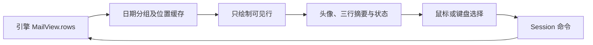
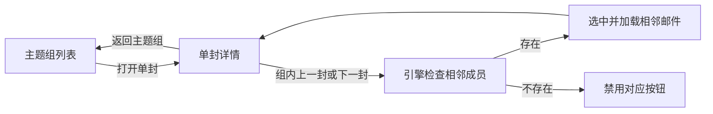

# 邮件列表显示

邮件列表采用头像与三行摘要布局，便于快速区分发件人、主题和正文预览。绘制由 `crates/ui-egui/src/list.rs` 负责，数据与操作仍由引擎提供。

- 每行高 80 个 egui 逻辑单位；圆形头像直径 34，中文显示首字，英文显示前两个连续字母。收件箱头像来自发件人；已发送和草稿来自第一位收件人。缺少收件人时显示 `?`。
- 第一行显示发件人（或收件人）、主题组封数、附件标记和时间。未读发件人加粗，头像右下角显示未读点；主题组的未读、附件和红旗状态汇总全部成员。
- 第二行显示深色主题及红旗、回复状态；第三行显示浅灰正文预览。长文本只显示一行，超出宽度时省略。时间最多占文本区的 45%，为名字和状态留出空间。
- 选中项使用蓝色圆角背景，发件人和主题使用白色，时间与摘要使用较淡的白色。普通行的细分隔线从文本区开始；头像、分隔线与选中样式跟随明暗主题。
- 保留日期分组、主题归类、虚拟滚动、右键菜单与 Cmd/Shift 多选。视觉更新不改变邮件数据、排序或命令语义。

验证入口：`cargo run -p mailfabrica -- --demo --control 7981`。用控制通道 `ui.screenshot` 查看实际渲染，`ui.click` / `ui.key` 验证选择，`ui.inspect` 核对选中邮件与可见行。协议见 [control-protocol.md](control-protocol.md)。

## 聚合组内阅读

主题组列表按最新在前排列。打开一封后，阅读窗格顶部保留返回组列表的入口，并提供上一封、下一封按钮；
切换范围限定为该组当前仍在列表中的成员，首尾禁用，不循环或跨到其他组。

`Session::group_neighbor` 提供目标，`view.groupPrev` / `view.groupNext` 命令负责切换并沿用单封选择、正文下载和自动已读流程。
界面只发送命令；CLI/MCP 使用相同命令及启用状态。删除成员、重新收信或关闭归类后，目标随当前列表重新计算。

