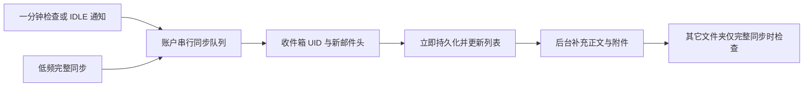

# 快速收件与增量显示

收件延迟由“等待下一次检查”和“本轮同步完成前不能显示邮件”两部分组成。新实现默认每 1 分钟检查收件箱，优先发布邮件头，再下载正文及附件；完整文件夹核对约每 10 分钟进行一次。用户将间隔设为 0 时关闭定时收件及 IDLE。

## 同步入口与范围

- 手动 `mail.sync {account?}`、添加账户和发送后的核对执行完整同步。移动/删除后通过 `startSyncFolders` 只核对源目录和目标目录，跳过无关目录、重复 LIST 和正文预取。
- 自动收件通过 `startSyncMode(account, true)` 仅检查已知收件箱，跳过重复 LIST 和历史邮件标记 FETCH。未知文件夹列表时先发现收件箱。
- 完整同步将收件箱排在其它文件夹之前；刷新文件夹列表、历史标记及删除状态。
- 用户间隔大于 10 分钟时，完整同步频率不高于用户设置的收件频率。启动后启用自动收取的真实会话会先做一次完整同步。

## 分阶段发布

`protocol.StreamingRemote.SyncStream` 通过 `SyncUpdate` 发布进展，由引擎持会话锁写 Store；网络线程不直接接触 Store。`Network.Sync` 保留一次性接口以兼容协议调用，演示 `Memory` 也提供相同的分阶段入口。

头部更新包含完整 UID 集合，仍能核对服务器删除及 UIDVALIDITY 重置。先发布 UID 核对结果以保留有效缓存，再将新邮件头按每批最多 100 封、较新 UID 优先发布；历史标记随后按 100 封一批刷新。每批只合并本次返回的元数据，不丢弃尚未更新的旧邮件，未读角标随快照刷新，范围仍与未读列表一致（排除垃圾邮件和已删除）。已完成首批后断线，重启同步会补取最近窗口内缺失的 UID，不会因为最大 UID 已变大而跳过未完成批次。`BodyOnly` 更新只写已有邮件的原文与预览，保留用户已设置的标记，不重新引入已被移走的邮件。后续正文或其它文件夹失败时，已经发布的新邮件继续可见，错误进入既有状态通道。预取上限仍由 `prefetch` 控制，未预取的邮件打开时按需下载；不开启正文自动已读。

## 计数与删除反馈

缓存索引在启动时即可提供侧栏计数。同步期间保留已知计数，收到新邮件头、已读标记或删除确认后逐批更新，不等其它文件夹和正文完成。`status.busyTasks` 区分邮件变更与后续目录核对：确认删除后先隐藏受影响角标，服务器变更结束后即可显示已更新的缓存计数；底栏继续报告目录核对进度。

列表和文件夹批量移动每批最多 100 个 UID；支持原子 MOVE 的服务器断线时，每批最多重连一次，先确认 UIDVALIDITY 及源目录仍存在的 UID，再只重试剩余部分。COPY 回退阶段失败不能确定是否已生成目标副本，保留错误并核对源、目标目录，不盲目重放 COPY。底栏进度、成功和错误统一占据一个布局区域；错误过长时省略显示，悬停可看完整原因，不再与旧错误文字重叠。

## IMAP IDLE

`protocol.InboxWatcher` 使用每账户一条独立只读连接监听收件箱，不占用变更队列。收到文件夹变化后通知自动收件调度，最多等待下一次 5 秒调度检查再启动快速同步；账户忙时保留待处理通知。IDLE 每 25 分钟续期，断线后每分钟尝试重连；定时检查始终保留。服务器不声明 IDLE 时停止建立监听，以定时检查工作。

关闭自动收取、账户移除或连接配置变化时，调度取消相应监听。密码只在建立连接和重连时读取。应用退出取消所有连接并等待后台任务结束。

协议参考：[RFC 2177](https://www.rfc-editor.org/rfc/rfc2177)、[go-imap v1 客户端 IDLE](https://pkg.go.dev/github.com/emersion/go-imap/client#Client.Idle)。

## 验证边界

- 引擎测试在正文阻塞期间确认新邮件头已可见，覆盖快速同步不动其它文件夹、正文补充保留标记、后续失败保留已显示邮件。
- 真正的本地 TCP IMAP 测试覆盖收件箱排序、头部先于正文、回调失败停止、IDLE 新邮件通知、取消、断线和能力回退。
- 浏览器验收使用隔离演示账户核对后台仍忙时的新邮件标题。测试耗时不能直接当作真实邮件服务商的到达延迟保证。
