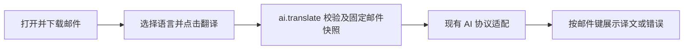

# AI 邮件翻译

阅读外语邮件时，在正文上方选择目标语言并点击「AI 翻译」。支持简体中文、繁体中文、英文、日文和韩文；默认目标语言跟随界面语言。译文单独显示，可收起并重新展开；原文始终保留，附件不参与翻译。

## 规则与命令

- 复用「设置 → AI 助手」的 Anthropic / OpenAI 兼容服务及密钥，不增加独立配置。只有用户显式点击才发送邮件主题和完整文字正文；不发送附件。
- `ai.translate {key?, language?}`：`key` 省略时使用当前邮件；`language` 为 `zh-CN`、`zh-TW`、`en`、`ja`、`ko`。程序化调用同样需先通过 `message.open` 下载正文，明确邮件键无需改变当前选择。
- 一次只运行一个翻译任务。没有正文、未配置服务、无效语言、网络/接口失败均返回明确错误。主题和正文合计最多 64 KiB，超限拒绝，不静默截断。服务报告输出达到 token 上限时按失败处理，不展示残缺译文。
- `Snapshot.aiTranslation` / `ai.status.translation` 包含 `key/language/busy/text/error`。结果仅驻留内存；切换邮件不会将旧结果显示在新邮件上。重新翻译替换上次结果，切换目标语言不会误标已有译文的语言。
- 不改写邮件、草稿或已读标记，不自动回复。AI 译文可能有误，可随时对照原文。

## 实现与验证

`internal/engine/translation.go` 管理参数、正文边界、异步状态；`internal/ai/client.go` 提供专用翻译指令并沿用现有超时和错误脱敏；`frontend/src/translation.tsx` 从会话快照读取结果，以纯文本渲染。CLI、MCP 和 UI 共享同一命令。

`internal/engine/translation_test.go` 使用本地假 AI 接口覆盖两种协议、完整输入、错误、重复请求、切换邮件及原文不变；不调用真实服务。
