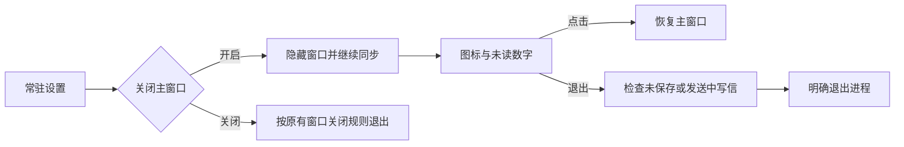

# 菜单栏常驻与未读数字

## 交互

设置 → 通用 → 窗口与后台中的“关闭窗口后常驻菜单栏 / 系统托盘”通过 `app.prefs {closeToTray: bool}` 持久化，默认关闭；关闭常驻时，关闭主窗口会正常退出，未保存邮件会确认。

开启后关闭主窗口会隐藏窗口，后台同步继续运行。macOS 同时隐藏 Dock 和应用切换器中的入口，仅保留菜单栏图标及未读数字；左键点击菜单栏/托盘图标恢复原窗口及原尺寸，并恢复 Dock 图标。右键菜单提供打开、收取邮件、设置和退出。显式退出仍退出进程，正在发送或存在未保存写信时会提示。关闭写信窗口仍按现有保存草稿/丢弃逻辑处理。

关闭常驻设置会移除图标；若主窗口隐藏则先恢复，避免失去打开入口。macOS 的 Dock 重开同样恢复主窗口。

## 数字规则

- 数字为所有已添加账户的收件箱未读邮件总数，不按当前选中文件夹或聚合会话计数。
- 不包含草稿、归档、垃圾邮件、已删除等目录。读取、标记未读和后台同步后同步更新。
- 未读为零时保留信封图标并隐藏数字。macOS 在图标旁显示完整数字；Windows/Linux 把数字绘入图标，超过 99 显示 `99+`，提示文字和菜单显示完整数量。
- Linux 图标是否可见取决于桌面环境对 StatusNotifierItem 的支持；Windows 图标可能位于通知区域折叠菜单。

## 实现

`internal/engine/desktop.go` 在引擎锁内返回轻量宿主状态，不需要前端轮询保持可见，也不序列化邮件正文。`internal/desktop/tray.go` 仅在状态变化时于 Wails UI 线程更新原生托盘。macOS 的 `dock_darwin.go`/`.m` 在同一 UI 线程切换 AppKit 的 `regular`/`accessory` 策略；Windows/Linux 不改变现有任务栏行为。图标由 `tray_icon.go` 绘制，不引入素材文件或字体依赖。

固定控制接口提供 `ui.tray`、`ui.closeWindow`、`ui.showWindow`，便于在无前端窗口时验证后台存活及窗口恢复。配置和邮件标记仍使用统一引擎命令。

原生回归验收：在 macOS 图形桌面执行 `make build && python3 scripts/native-smoke.py`。脚本使用临时演示目录，连续关闭/恢复三次，并通过独立 Swift 进程读取系统应用策略，验证 Dock 隐藏及恢复；同时检查窗口隐藏时徽标变化、关闭设置后恢复窗口及 Dock、零未读隐藏数字和正常退出。它不打开真实数据目录，不签名或公证。窗口恢复和 Dock 策略变更必须在 Wails UI 线程执行，避免 Cocoa 的 `NSApp unhide` 在工作线程触发 SIGTRAP。
