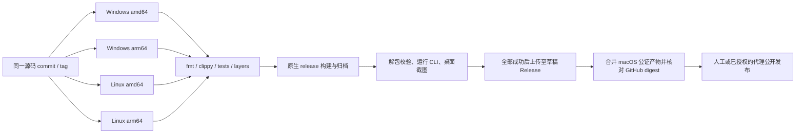

# 跨平台发布

## 领域与平台

同一个版本标签生成 macOS、Windows 和 Linux 产物，包内同时包含桌面程序与 CLI。`amd64` 是 `x86_64` 的发布名称，`arm64` 是 `aarch64`；禁止根据运行机器名称猜测另一个架构。

| 平台 | 架构 | 产物 | 验证环境 |
|---|---|---|---|
| macOS | arm64 | `.app` 与 `.dmg` | 本地原生构建、Developer ID、Apple 公证 |
| Windows | amd64、arm64 | `.zip` portable | Windows 2022、Windows 11 Arm 原生 runner |
| Linux | amd64、arm64 | `.tar.gz` portable | Ubuntu 22.04 的两个原生架构 runner |

Windows 发布包使用静态 CRT，解压后运行 `mailfabrica.exe`，CLI 为 `mailfabrica-cli.exe`。Linux 运行 `./mailfabrica` 或 `./mailfabrica-cli`，要求 glibc 2.35 或更新版本及正常的图形驱动、fontconfig 和 libxkbcommon-x11；中文字体建议 Noto CJK。包内包含许可证、安装说明、共享图标、构建记录；Linux 另带 `.desktop` 文件。

Ubuntu/Debian 运行依赖：`sudo apt install libfontconfig1 libxkbcommon-x11-0 libvulkan1 mesa-vulkan-drivers fonts-noto-cjk`。X11 键盘库由窗口库动态加载，单独运行 `ldd` 无法发现它缺失，因此发布验收必须实际启动 GUI。

Windows/Linux 更新入口打开官方发布页，由用户选择架构、解压并替换旧版。macOS 的自动下载、SHA-256、Apple 发布者与 Gatekeeper 校验保持独立，不把这套信任规则静默套用到其他系统。

## 实现边界

- `crates/brand`（L0）只负责原创矢量图标的 PNG、ICO 和 RGBA 编码，不依赖 core、UI、网络或存储。增加此独立模块是为了让窗口图标、Windows PE 资源和打包工具共享唯一源素材，避免在业务 core 中引入图形职责或保存位图。
- `apps/mailfabrica/build.rs` 在 Windows 目标生成 ICO 并嵌入 PE 图标/产品版本资源；运行窗口使用同一 RGBA，macOS 保留 bundle 图标。
- `xtask/src/portable.rs` 只在对应原生 OS/架构运行，拒绝 `CARGO_BUILD_TARGET`。归档失败清理临时目录，不覆盖现有发布包。
- `xtask/qa.py` 是交付验收工具：检查归档和包内哈希、PE/ELF 架构、Windows 图标资源、CLI 响应与演示桌面截图，关闭自己启动的进程。测试不使用真实账户。
- `.github/workflows/portable.yml` 使用固定 SHA 的官方 Actions；构建 job 只读仓库，只有全部平台成功后的上传 job 能写 Release。

## 流程



先在发布分支构建并查看四种截图，再合并到 `master`、打正式标签。tag push 重新构建该标签；也可通过 workflow_dispatch 指定 ref。`publish=false` 只生成 Actions artifacts，`publish=true` 要求稳定版本、标签指向当前 commit 并属于 `origin/master`。

上传前核对四种归档都来自同一 commit。每种平台都有独立 `.json` 与 `.sha256`，避免多架构的 `build.json` 相互覆盖。重跑只复用 digest 完全相同的既有资产；拒绝覆盖不同资产或修改已公开的 Release。公开发布前将 macOS 公证包和完整更新说明一起加入草稿并验证全部资产。

## 本地运行

原生系统安装 Rust、C/C++ 编译工具、CMake。Windows 使用 MSVC 与 Windows SDK；正式 Windows 包设置 `RUSTFLAGS=-C target-feature=+crt-static`。Linux 需要 clang、fontconfig/freetype、X11/Wayland 图形开发库及 Vulkan 驱动。

```sh
cargo xtask ci
cargo xtask package
```

正式包设置 `MAILFABRICA_RELEASE=1`。产物在 `dist/MailFabrica-<version>-<platform>-<arch>/`，目录内包含归档、校验文件与构建记录。macOS 签名与公证配置见 [本地构建](local-build.md)。
