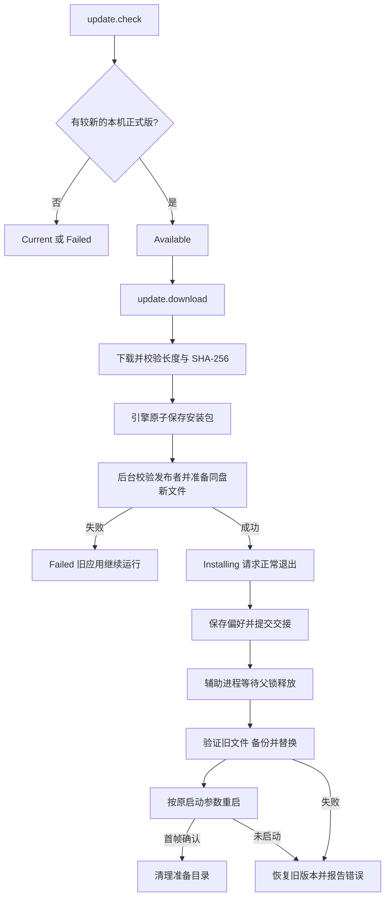

# 应用更新领域

## 背景与边界

应用从固定 `OpenFabrica/mailfabrica` GitHub 发布源检查正式版，下载本机资产，校验后自动替换并重启。macOS 更新整个 `.app`；Windows/Linux portable 更新已安装的应用文件。邮件、账户、钥匙串和不属于应用的文件不进入替换计划。首次启动不自动检查。

`crates/update`（L3）封装网络、完整性、Apple 发布者校验、解压、安装准备和辅助进程事务；不依赖 egui、Store 或邮件同步。引擎持有更新状态；宿主注入当前可执行文件、启动参数及数据目录，公开命令不能指定路径或下载来源。

## 规则

- 仅接受比当前版本更新的稳定版；草稿、预发布、缺本机资产或缺 SHA-256 digest 都不能安装。macOS arm64/Intel 使用 DMG，Windows amd64/arm64 使用 ZIP，Linux amd64/arm64 使用 TAR.GZ。
- 安装包长度及 SHA-256 必须与 GitHub 元数据匹配，最大 128 MiB。安装准备使用私有副本，避免缓存变化影响解压。
- macOS 验证 DMG 和应用的完整签名、TeamIdentifier `HQ537XMLJY` 与 Gatekeeper 公证信任。Windows/Linux 尚无独立发布者签名，信任依赖固定官方 HTTPS 来源及 API digest；归档内 `build.json` 的版本、平台、CPU 和二进制哈希必须一致。
- Portable 只解压已知叶子文件，拒绝路径穿越、重复条目、链接、设备节点；最多 32 个归档条目，解压最多 256 MiB。程序启动版本必须匹配发布版本。
- 安装目录必须可写。macOS 拒绝从 `/Volumes` 更新；邮件数据不能位于 `.app` 内。准备目录位于应用旁的同盘私有目录，权限由 tempfile 限制。开发 `target` 目录不执行安装。
- 写信未保存时禁止更新；下载和准备期间再次检查，防止中途输入丢失。邮件同步不属于更新任务，退出前已写入的本地数据继续保留。
- 每个会话至多一个更新任务；迟到事件按任务号丢弃。关闭弹窗不取消更新，关闭会话则停止接收未交接的任务。
- 辅助进程来自已验证的新应用。macOS 保留完整签名 bundle，避免单独复制绑定 Info.plist 的 Mach-O 被系统拒绝执行。父进程持有文件锁；只有正常退出提交 `commit` 后才能替换。异常关闭、取消、锁等待 60 秒超时均不替换。
- 替换前再次验证旧文件哈希及新文件；按项备份和 rename。任何一步失败回退。新 GUI 必须在 30 秒内完成首帧确认，否则收割失败进程、恢复旧版并重启显示错误。无法恢复时保留备份路径。成功后清理临时安装文件。

## 流程

## 命令与宿主

| 命令 | 参数 | 行为 |
|---|---|---|
| `update.check` | `{}` | 检查；忙碌时禁用 |
| `update.download` | `{}` | 下载、验证、自动准备及安装重启 |
| `update.open` | `{}` | 保留原命令 ID，重新验证已下载包后安装 |
| `update.cancel` | `{}` | 取消准备阶段，旧应用继续运行 |
| `update.status` | `{}` | 查询阶段、版本、字节数、缓存路径和错误 |

阶段包括 `idle`、`checking`、`current`、`available`、`downloading`、`verifying`、`installing`、`ready`、`failed`、`cancelled`。`manual` 保留给自定义发布客户端，固定 GitHub 客户端不再走此分支。`app.status.busy` 包括更新。

GUI 宿主配置安装目标，收到 `RestartForUpdate` 后正常退出并在退出回调提交。启动参数中的 `--demo`、`--data`、控制端口会保留。控制通道或连接 GUI 的 MCP 使用同一更新命令。独立无窗口 CLI/MCP 未配置安装目标时止于 `ready`，返回验证过的包路径；不会误替换 CLI 或另一份 GUI。

0.1.0/0.1.1 内置的旧更新代码仍会打开安装器，它们不能在未安装新版代码前自动获得此能力。自动替换从含此实现的版本开始生效；已有发布标签和资产保持不变。

## 验证

`cargo xtask ci` 覆盖平台资产、完整性、安全解压、部分替换失败恢复、父锁与提交、未保存写信门禁、缓存篡改和命令链。`cargo xtask update-qa <package> <version> <qa-executable> <port>` 仅允许系统临时目录内带 `mailfabrica-update-qa-` 标识的安装，验证真实辅助进程、GUI 重启和用户文件保留。四个 native CI job 在归档截图验收后执行此流程；macOS 对最终公证包另行执行。

更新弹窗关闭 Area 淡入；更新说明固定换行与滚动区域大小，避免遮罩透明度随可见性和布局变化。逐帧测试检查只有一个 alpha=100 的全窗遮罩；持续闪烁的现场验收由用户完成。
