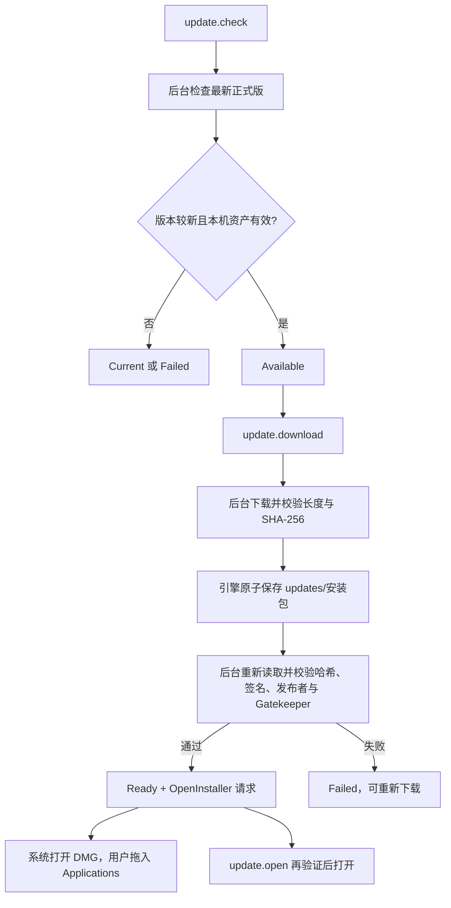

# 应用更新领域

## 背景与边界

公开分发的 macOS 客户端需要找到正式版、下载正确架构的安装包并打开安装器。用户自行拖入 Applications，退出并重新启动应用；更新流程不替换正在运行的程序，不修改邮件账户或钥匙串。首次启动不隐式联网检查更新。

新增 `crates/update`（L3）集中封装 GitHub 网络、完整性校验与系统签名验证，避免这些基础设施进入 UI 或邮件同步线程。它不依赖 Store、sync 或 egui。引擎仍是唯一状态和存储入口，界面、CLI、MCP 使用同一组命令。

## 概念与规则

- Release：固定 `OpenFabrica/mailfabrica` 仓库的最新非草稿、非预发布版本。用 semver 比较，只有比运行版本更新才提供下载。
- Installer：严格匹配 `MailFabrica-<version>-arm64.dmg` 或 `x86_64.dmg` 的资产，下载地址必须匹配该仓库与版本；没有本机架构资产时报告错误。
- 完整性：GitHub API 的 `sha256:` digest 和资产长度都必须匹配；安装包最多 128 MiB，元数据最多 2 MiB。
- 发布者：macOS `codesign --verify --strict`、证书 TeamIdentifier `HQ537XMLJY` 和 Gatekeeper assessment 都通过才允许打开。重新打开缓存前再次验证，防止缓存被修改。
- 任务：每个会话只允许一个更新任务；任务号过滤迟到结果。所有失败清除忙碌状态，保留可用发布信息以便重试。
- 超时：发布检查 20 秒，下载 180 秒，连接 10 秒，每条系统验证命令 60 秒。关闭会话取消后续下载读取并丢弃结果，不再自动打开安装器。

## 流程

`update` 线程不写磁盘；引擎用 `Store::save_installer` 保存文件。验证线程只读取已保存安装器并调用固定系统工具，不访问邮件存储。失败文件没有可打开的状态；重新下载原子覆盖，临时文件保存失败时清理。

## 命令与状态

| 命令 | 参数 | 行为 |
|---|---|---|
| `update.check` | `{}` | 启动检查；忙碌时禁用 |
| `update.download` | `{}` | 下载检查出的更新；验证成功后请求打开安装器 |
| `update.open` | `{}` | 重新验证并打开已下载的安装器 |
| `update.status` | `{}` | 查询 phase、release、received、installer 和 error |

阶段：`idle`、`checking`、`current`、`available`、`downloading`、`verifying`、`ready`、`failed`。`current` 包括尚无正式发布和没有更新版本。`app.status.busy` 包括更新任务，并附带 `update` 状态。

GUI 执行异步命令，轮询 `update.status`；无窗口 CLI/MCP 会等待到空闲或原有 120 秒上限，返回当时状态，不启动系统安装器。超过等待上限时可继续查询状态，`ready.installer` 给出本地路径。连接 GUI 的控制通道/MCP 会由 GUI 打开安装器。任何命令都不接受外部 URL、版本或任意本地路径。

## 验证

`cargo xtask ci` 覆盖版本排序、本机资产选择、缺摘要、过大文件、截断/哈希损坏、错误发布者、重复任务、失败重试、迟到事件、缓存篡改和完整命令链。真实界面检查就地忙碌状态、更新按钮与关闭行为；公开发布后从真实 GitHub 资产验证下载及 Apple 签名。
